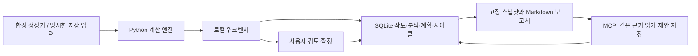

# 투자에이전트 + Invest Agent Workbench

**같은 근거를 보며 사람과 AI가 투자 가설을 검토하는 로컬 작업대.**

종목을 고르고 차트에 선을 그은 뒤 AI와 논의해도, 다음 대화에서 어떤 자료와 조건을 기준으로 판단했는지 잃어버리기 쉽습니다. 이 프로젝트는 가격·재무·작도·보고서를 하나의 분석건과 고정된 스냅샷으로 연결합니다. 수치 계산은 Python이 맡고, AI의 제안과 사용자가 확인한 계획은 별도 기록으로 남깁니다.

2026-10-18 공개 후보에는 기존 Python 엔진에 최신 워크벤치 UI와 MCP 연결을 더했습니다. **실제 개인 자료 없이 실행할 수 있는 합성 데모**가 포함됩니다. 화면만 재현하는 목업이 아니라 차트 작도, 보고서, 계획 버전, 사이클 계산을 SQLite와 Markdown으로 저장합니다. 주문 기능은 없습니다.

## 5분 실행

Python 3.12 이상이 필요합니다. 저장소를 받은 폴더에서 실행합니다.

```sh
python -m venv .venv
# Windows PowerShell
.venv/Scripts/python -m pip install -r requirements-demo.txt
.venv/Scripts/python demo.py
# macOS/Linux에서는 위의 .venv/Scripts/python을 .venv/bin/python으로 바꿉니다.
```

브라우저에서 `http://127.0.0.1:8765`를 엽니다. 포트가 사용 중이면 `python demo.py --port 8876`으로 바꿀 수 있습니다. 기본 준비에 수십 초가 걸릴 수 있습니다. 첫 실행은 가상의 한국·미국 기업 10개, 가격 380봉, 재무 5개년·12분기, 예시 계좌·보고서·매매 사이클을 생성합니다. 모든 숫자·기업·대화 예시는 실제 투자 기록과 무관합니다. 데모 기준일은 **2026-10-16**으로 고정하며, 경고 화면은 현재 날짜와의 차이를 그대로 표시합니다.

1. **스크리닝 → 종목 상세:** 선별 근거를 읽고 일·주·월봉, SMA 5/10/20/50/100/150/200을 비교합니다. `DEMO1`을 검색하면 예시 보고서가 연결된 종목을 열 수 있습니다.
2. **작도 · SMA → 재무정보 → 정성 리포트:** 선을 수정하고 저장한 뒤 새로고침합니다. 재무 원값과 계산 근거, YoY/QoQ, EPS, 주주환원을 확인합니다. 분석건과 보고서는 재실행 후에도 남습니다.
3. **매매 사이클:** 예시 초안에서 20/30/50 배분의 36가지 조합 × 상승·횡보·하락 3경로를 비교합니다. 초안·사용자 확정·가상 체결 기록은 분리됩니다.

`workbench/runtime/`에는 실행 상태와 새 기록이 생기며 Git에서 제외됩니다. 다른 실험은 `--state-dir workbench/runtime/another-demo`로 분리하세요. 종료는 터미널의 `Ctrl+C`입니다. 데모는 시작하거나 화면을 새로고침할 때 외부 시세·계좌·LLM을 호출하지 않습니다.

## 구현한 기능

| 영역 | 공개 후보에서 실행할 수 있는 기능 |
|---|---|
| 시장·스크리닝 | 추세/조정/돌파, 스페란데오, 바닥 관찰, 하락 추세선 근접, 섹터별 거래활동 변화와 제외 근거 |
| 차트 | 일·주·월봉, 일봉 기준 공유 작도, 7개 SMA, 최근 추세선, 가격 사건과 확인 시점 구분 |
| 재무 | 연간 5개·분기 12개, YoY/QoQ, 기본/희석 EPS, 부채·유동비율, 은행/IFRS 처리, 배당·자사주·주주환원 |
| 사람–AI 협업 | 변경되지 않는 근거 스냅샷, 정성 보고서·출처, 후속 논의, 계획 버전, 사용자가 확인한 채택 기록 |
| 시나리오·가격 경고 | 저장된 작도에 대한 완료봉 감시, ATR 접근폭, 보유 이후 고점 95%·MA5/MA10 관찰, 알림 중복 방지 계산 |
| 매매 사이클 | 최대 3회 분할 진입/청산, 108개 결과, 현금·정수 수량·잔여 물량 장부, 초안/확정/체결/재진입 이력 |
| 연구 | 이동평균 9개 진입·청산 조합, 하락폭/청산/재진입/초기경고 연구 계산과 합성 회귀 검사 |

데모에 표시되는 후보 개수는 생성된 가격을 실제 선별 함수에 넣은 결과입니다. 모든 유형의 후보가 항상 생기도록 결과를 강제하지 않습니다. 실제 전 시장 수집, 개인 브로커 인증, Telegram 로그인·뉴스·발송, 예약 작업은 공개 후보에서 제외했습니다. [기능별 경계와 이전 버전 차이](docs/PUBLIC_CANDIDATE_2026_10_18.md)

## 구조와 설계 선택



- **같은 입력:** 스냅샷 ID와 SHA-256으로 당시 근거를 다시 읽습니다. 새 자료를 읽는 것과 과거 판단을 재생하는 것을 구분합니다.
- **계산과 해석:** 가격 조건·비율·수량·현금은 Python에서 계산합니다. AI가 쓴 문장이나 작도 제안은 사실·체결·사용자 승인으로 취급하지 않습니다.
- **권한과 이력:** localhost Host/Origin 확인, 역할별 capability, 브라우저 확인, revision 충돌 검사와 SQLite 트랜잭션을 사용합니다. 서버는 `127.0.0.1`에만 바인딩합니다.
- **자료의 한계:** 결측과 0, 조건 충족과 매수 판단, 발생 시점과 확인 시점을 구분합니다. 가격 관찰은 예측력이나 수익성을 입증하지 않습니다.

```text
src/invest_agent/       기존 공개 엔진·계좌/포트폴리오/연구 계산
workbench/scripts/     최신 UI 백엔드·분석·재무·사이클·연구
workbench/dashboard/   HTML/CSS/JavaScript와 라이선스 보존한 차트 라이브러리
workbench/tests/       합성 계산·저장·권한·MCP 테스트
demo.py                오프라인 공개 데모
workbench-mcp.py        최신 워크벤치 MCP 진입점
research-demo.py        합성 가격으로 9개 MA 조합 비교
tests/                 기존 공개 엔진 회귀 검사
```

## MCP 연결

데모를 먼저 실행한 후 MCP 클라이언트에서 같은 가상환경의 Python으로 `workbench-mcp.py`를 실행합니다. 경로는 본인의 checkout 위치로 지정합니다.

```json
{
  "mcpServers": {
    "invest-workbench": {
      "command": "python",
      "args": ["<checkout>/workbench-mcp.py"]
    }
  }
}
```

도구는 분석건·스냅샷·보고서·후속 논의·계획·감시·사이클을 읽고 제안을 저장합니다. 브라우저 확인을 대신해 채택하거나 주문하지 않습니다. 역할별 토큰은 실행 중 생성되는 로컬 파일에만 저장되며 공개 파일에 포함하지 않습니다. 연결 실패 시 운영 서버를 찾거나 재시작하지 않습니다. 기존 설치형 `invest-workbench-mcp`는 v2.4 호환 인터페이스이며 최신 데모 연결은 위 진입점을 사용합니다.

정성분석 실행 버튼은 Codex와 별도로 설치한 `stock-qualitative-analysis` 스킬을 전제로 합니다. 해당 개인 스킬은 이 패키지에 포함하지 않습니다. 일반 MCP 클라이언트에서도 저장 근거를 읽고 보고서·논의·계획을 명시적으로 기록할 수 있습니다.

Codex를 이용한 **자동 초안 생성은 기본 비활성화**입니다. 외부 AI로 전송할 자료를 검토한 후 `INVEST_ENABLE_CODEX_DRAFT=1`을 직접 설정한 환경에서만 사용할 수 있습니다. 연결한 AI 클라이언트로 MCP 자료를 읽으면 그 클라이언트로 자료가 전달됩니다. 합성 데모는 API 키 없이 탐색하고 기존 초안을 비교할 수 있습니다.

## 검증과 연구 재현

```sh
# 소스 checkout의 src를 사용하도록 검사 런처가 설정합니다.
python scripts/test_public_candidate.py
python research-demo.py
python demo.py --build-only --state-dir workbench/runtime/check
```

[검증 범위와 확인하지 않은 영역](docs/PUBLIC_CANDIDATE_VALIDATION.md)을 별도로 기록했습니다. 실제 공급자 호출·실계좌·외부 LLM·메시지 발송을 성공한 기능으로 주장하지 않습니다. 연구 예시는 계산 재현용이며 실제 과거 시장 성과표를 배포하지 않습니다. 기존 엔진 CLI와 포트폴리오 예시는 [TRADING.md](TRADING.md), [시나리오 계산](docs/PORTFOLIO_SCENARIOS.md), [합성 시장 연구](docs/SYNTHETIC_MARKET_REVIEW.md)에 있습니다.

## 공개 범위

공개 소스·테스트·생성한 예시·설명서만 포함합니다. 실제 계좌·매매일지·판단 기록, DPAPI/세션/API 키, 개인 경로·연락처, 원본 PDF·강의 전사·공시 캐시·DB·스크린샷과 비공개 Git 이력은 포함하지 않습니다. 이 패키지는 개인 작업 환경 전체의 백업이 아닙니다.

일부 공식 자료 수집 코드와 기존 공개 공급자 어댑터는 명시적으로 호출할 때 외부 통신을 수행합니다. 기본 데모는 주입한 합성 어댑터만 사용합니다. 자료 제공자의 현재 이용조건이나 재배포 권리를 검증했다는 뜻은 아닙니다. [공개 검수 정책](PUBLICATION.md)

라이선스는 [LICENSE](LICENSE)를 따릅니다. Lightweight Charts와 trendln의 라이선스·NOTICE는 해당 vendor 폴더에 보존했습니다.
